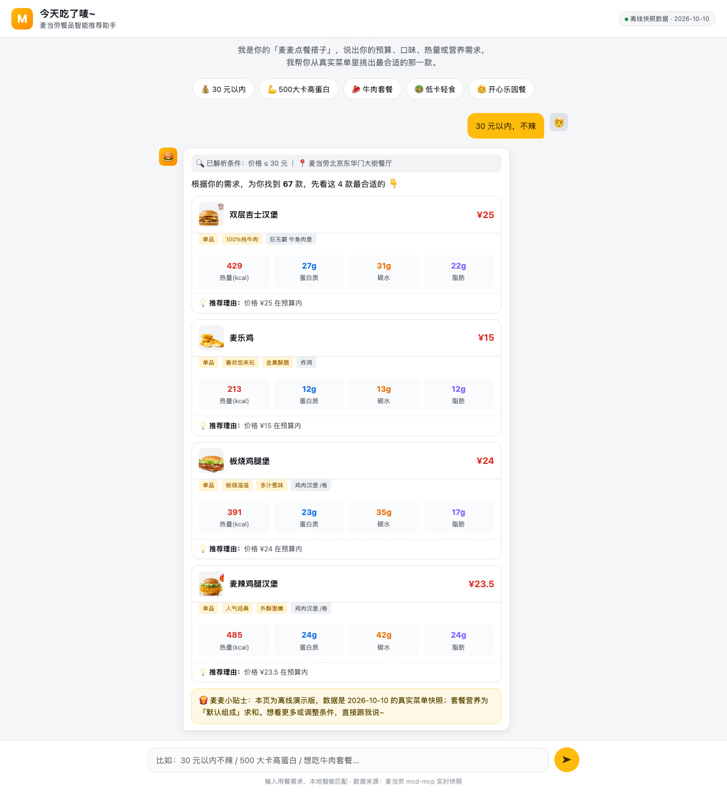

# 今天吃了唛~


> 麦当劳餐品智能推荐 Skill · 麦当劳程序员节创意开发大赛参赛作品

一个懂麦当劳、也懂营养搭配的"麦麦点餐搭子"。你说出想要的类型——价格区间、口味、营养搭配、热量、套餐等任意条件，它调用麦当劳官方 MCP 获取**真实在售**的餐品数据，筛选出最适配的餐品/套餐，并附带**价格、热量、蛋白质、碳水、脂肪**信息。没有完全匹配的？它会给你一个最接近的推荐，并说清楚差在哪。

## 项目简介

- **名称**：今天吃了唛~
- **能力**：基于麦当劳 MCP（mcd-mcp），按用户条件智能筛选餐品并给出营养化推荐。
- **数据源**：麦当劳官方 MCP 实时菜单、价格与营养数据（非静态、不编造）。
- **输出**：餐品/套餐清单，含价格、热量（kcal）、蛋白质、碳水化合物、脂肪及推荐理由。

### 支持的筛选维度

| 维度 | 说明 |
|---|---|
| 价格区间 | 如"20 元以内""30-40 元" |
| 口味偏好 | 辣/不辣、牛肉/鸡肉/鱼/素、甜/咸 |
| 营养搭配 | 高蛋白、低脂、低糖、均衡 |
| 热量区间 | 如"500 大卡以下" |
| 套餐类型 | 单品、套餐、双人餐、多人拼盘、开心乐园餐 |
| 用餐场景 | 到店自取 / 麦乐送外送 / 得来速 |

## 目标用户

- 每天纠结"中午吃什么"的打工人
- 关注热量与营养、想吃得健康的健身/减脂人群
- 给娃选开心乐园餐的家长
- 想快速组一桌多人餐的聚会组织者

## 项目结构

```
mcd-innovation-challenge/
├── README.md                 # 项目介绍、安装方法、使用示例、目标用户（本文件）
├── CONTEST_DECLARATION.md    # 参赛声明（官方原文，不可改动）
├── MCP_INTEGRATION.md        # MCP Server / Tool / 调用流程 / 业务价值说明
├── mcp-config.example.json   # 脱敏 MCP 配置示例（Token 用环境变量占位符）
├── workbuddy.md              # WorkBuddy 开发对话上下文（联动奖励核验）
├── demo.py                   # 命令行演示脚本（内置营养+菜单快照，可离线跑通）
├── skills/
│   └── jintian-chile-me/
│       └── SKILL.md          # Skill 核心逻辑与工作流程
└── web/                      # 豆包式对话推荐网页（带后端）
    ├── index.html            # 前端：对话 UI + 推荐卡片渲染
    └── server.js             # 后端：直连 mcd-mcp 实时数据 + 决策引擎
```

## 安装方法

### 前置条件

1. 申请麦当劳中国 MCP Token：<https://open.mcd.cn/mcp>（登录后进入控制台激活）。
2. 准备一个支持 Streamable HTTP 的 MCP Client，推荐 **WorkBuddy**。

### 步骤一：配置 MCP Server

在 MCP Client（以 WorkBuddy 为例）的【连接器】→【自定义连接器】→【配置 MCP】中填入：

```json
{
  "mcpServers": {
    "mcd-mcp": {
      "type": "streamablehttp",
      "url": "https://mcp.mcd.cn",
      "headers": {
        "Authorization": "Bearer YOUR_MCP_TOKEN"
      }
    }
  }
}
```

> ⚠️ 将 `YOUR_MCP_TOKEN` 替换为你的真实 Token，保存并启用 `mcd-mcp`。

### 步骤二：安装 Skill

将 `skills/jintian-chile-me/` 目录放置到你的 MCP Client 的 Skill 目录（WorkBuddy 用户级目录为 `~/.workbuddy/skills/`，项目级为 `{workspace}/.workbuddy/skills/`），即可在对话中触发。

## 使用示例

**示例 1 · 价格筛选**

> 用户：今天吃了唛~ 给我推荐 30 元以内、不辣的一顿。

输出：麦香鸡套餐（¥33）超出预算 → 推荐最接近的"双层吉士汉堡（¥25）"或"吉士汉堡包套餐（¥31）"，并说明热量与营养。

**示例 2 · 热量 + 营养**

> 用户：500 大卡以内、高蛋白的健康餐。

输出：按热量过滤 + 蛋白质降序，推荐如"板烧鸡腿堡""麦乐鸡"等，并附 kcal/蛋白质/碳水/脂肪。

**示例 3 · 套餐**

> 用户：给我配一套 40 元左右的牛肉套餐。

输出：拆包"巨无霸三件套（¥42）"组成，求和营养后展示套餐总热量与三大营养素。

## Web 演示（豆包式对话）

项目附带一个**豆包风格的对话式推荐网页**，可直观体验完整推荐流程。

**🌐 在线体验：<https://alexandervii.github.io/mcd-WhatToMc/>**（纯前端离线版，点开即用）

### 界面截图

**欢迎页**——说出预算、口味、热量或营养需求，或点击快捷标签一键体验：


**对话推荐**——输入「30 元以内，不辣」后的推荐结果，每个餐品附带价格、热量与三大营养素、推荐理由：




### 架构

```
浏览器 (web/index.html)
   │  POST /api/recommend  {text: "30 元以内不辣"}
   ▼
Node 后端 (web/server.js)   —— 零第三方依赖，仅内置 http/https
   │  tools/call (Streamable HTTP)
   ▼
麦当劳 MCP (https://mcp.mcd.cn)  —— 实时菜单 / 价格 / 营养 / 套餐数据
```

- **前端**：豆包式聊天界面（气泡、输入框、快捷条件标签），输入自然语言 → 回显解析条件 → 渲染推荐卡片（价格 + 热量/蛋白质/碳水/脂肪四宫格 + 推荐理由）。
- **后端**：直连 mcd-mcp 拉实时数据，复现 SKILL.md 的完整决策逻辑（解析条件 → 定位门店 → 拉营养/菜单 → 筛选打分 → 套餐动态拆包求和 → 返回 JSON）。

### 启动方式

```bash
cd web
node server.js      # 默认端口 8787，浏览器访问 http://localhost:8787/
```

> Token 从 `~/.workbuddy/mcp.json` 读取；未指定位置时用默认门店（北京东华门大街餐厅）兜底。

### 营养估算兜底

`list-nutrition-foods` 营养表未覆盖部分 2026-10 新品（如"龙焰"系列）。当套餐主餐营养缺失时，后端会按**品类近似匹配**（鸡腿堡/牛堡/鱼堡/鸡翅/卷/炸鸡等）取同类已知单品的营养均值估算，并打 `estimated` 标记，前端明确标注「⚠️ 营养为同类餐品估算值」，绝不把估算值伪装成精确值。

### 命令行演示

`demo.py` 是一个可离线运行的演示脚本，内置营养 + 菜单 + 套餐组成快照，用真实数据跑通「营养筛选 + 价格筛选 + 套餐营养求和」链路。运行：

```bash
python3 demo.py
```

## 说明

本项目为麦当劳程序员节创意开发大赛参赛作品，非麦当劳官方产品。餐品信息、价格及供应状态以麦当劳官方渠道实时结果为准。
